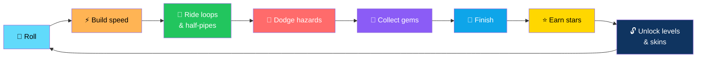
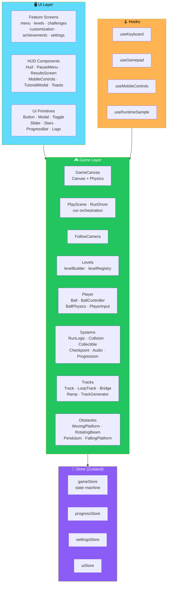

# 🎱 Ball Loop 3D

<div align="center">


**Roll a physics-driven ball through twisting tracks, genuine vertical loops, half-pipes, and hazards.**

*10 levels · 3 game modes · 12 achievements · 9 ball skins · Everything procedural*

[🚀 Install](#-installation) • [🎮 Controls](#-controls) • [✨ Features](#-overview-and-key-features) • [🏗️ Architecture](#-project-structure) • [🔧 Extending](#-adding-a-level)

</div>

---

## 📖 Overview

**Ball Loop 3D** is a **3D arcade ball-rolling game** that runs in the browser.

Roll a **physics-driven ball** through twisting tracks, **genuine vertical loops**, half-pipes, moving platforms, and hazards.

**Collect gems, earn stars, and unlock ball skins.**

> ✅ **Everything is procedural** — geometry, textures, sound.
>
> **Saved locally — no backend, no network access at runtime.**

### The Core Loop



---

## ✨ Overview and Key Features

<div align="center">

| 🎱 Real Physics | 🎥 Third-Person Camera |
|:---:|:---:|
| Dynamic **Rapier** ball · acceleration/deceleration · friction · air steering · configurable jump · **coyote time** · **jump buffering** · slope/bank handling · **grip assist that lets it ride loops** at speed | Follow camera · adjustable distance · mouse/touch/stick rotation · auto-recentre · **camera collision** · **fall recovery** |
| **🛤️ Track Pieces** | **🎮 Game Modes** |
| Straights · narrow bridges · curves · ramps · launches · gaps · **physical vertical loops** · half-pipes · moving platforms · rotating beams · pendulum hammers · falling platforms · boost pads · slow zones · checkpoints · finish gates · gems | **Adventure** (10 levels) · **Time Trial** · **Endless Loop** (seeded, streamed, ever-harder) · **Daily Challenge** (deterministic from local date) |
| **🏆 Progression** | **🎨 Presentation** |
| 1–3 stars per level · gems · perfect-run bonus · personal bests · **12 achievements** · **9 ball skins** bought with gems | Glossy physical-material ball · neon accents · particles · speed trail · procedural audio · quality setting · animated 3D menu background |
| **🕹️ Input** | |
| Keyboard · mouse · touch joystick + jump · gamepad | |

</div>

### 🎱 Real Physics

Powered by **Rapier**.

**Features:**

- **Dynamic ball** with acceleration and deceleration
- **Friction** and **air steering**
- **Configurable jump**
- **Coyote time** — jump briefly after leaving an edge
- **Jump buffering** — queue a jump slightly before landing
- **Slope and bank handling**
- **Grip assist that lets the ball ride loops** when it carries enough speed

### 🎥 Third-Person Camera

- **Follow camera** with **adjustable distance**
- **Mouse / touch / stick rotation**
- **Auto-recentre**
- **Camera collision**
- **Fall recovery**

### 🛤️ Track Pieces

**Straights · narrow bridges · curves · ramps · launches · gaps**

**Special features:**

- **Physical vertical loops**
- **Half-pipes**
- **Moving platforms** *(horizontal and vertical)*
- **Rotating beams**
- **Pendulum hammers**
- **Falling / disappearing platforms**
- **Boost pads** and **slow zones**
- **Checkpoints** and **finish gates**
- **Gems**

### 🎮 Game Modes

| Mode | Description |
|------|-------------|
| **Adventure** | 10 levels — finishing unlocks the next |
| **Time Trial** | Replay unlocked levels for personal bests |
| **Endless Loop** | **Seeded, streamed, ever-harder** course — one fall ends the run |
| **Daily Challenge** | **Deterministic from the local device date** — no server, no leaderboard |

### 🏆 Progression

| Element | Details |
|---------|---------|
| **Stars** | ★ Finish · ★★ Beat the par time · ★★★ **Also meet the level challenge** *(collect all gems, no falls, or an expert time)* |
| **Gems** | Collected during runs, banked on completion |
| **Perfect-run bonus** | No falls |
| **Personal bests** | Stored per level |
| **Achievements** | **12** — each grants gems |
| **Ball skins** | **9** — bought with gems *(cosmetic only)* |

### 🎨 Presentation

- **Glossy physical-material ball**
- **Neon accents**
- **Particles** and **speed trail**
- **Procedural audio** via Howler.js
- **Quality setting** — low / medium / high
- **Animated 3D main-menu background**

### 🕹️ Input

- **Keyboard** — WASD / arrows
- **Mouse drag** — rotate camera
- **Touch** — on-screen joystick + jump button + look
- **Gamepad** — left stick roll, right stick camera, A or right trigger jump

---

## 🛠️ Technology Stack

<div align="center">

| Library | Version | Role |
|---------|---------|------|
| **Vite** | 8 | Build tool |
| **TypeScript** | Strict | Language |
| **React** | 19 | UI framework |
| **Three.js** | 0.186 | 3D rendering |
| **React Three Fiber** | 9 | React renderer for Three.js |
| **@react-three/drei** | 10 | R3F helpers |
| **@react-three/rapier** | 2 | Rapier physics |
| **Zustand** | 5 | State management |
| **Tailwind CSS** | 4 | Styling |
| **Howler.js** | — | Audio |
| **Vitest** | 5 | Testing |

</div>

---

## 📋 Prerequisites

- **Node.js 20.19+ or 22.12+** *(required by Vite 8)* and **npm**
- A browser with **WebGL2** — current Chrome, Edge, Firefox, or Safari

---

## 🚀 Installation

```bash
npm install
```

### 🖥️ Development Server

```bash
npm run dev
```

Open the printed URL *(default **http://localhost:5173**)*.

### 📦 Production Build

```bash
npm run build      # type-checks (tsc --noEmit) then bundles to dist/
npm run typecheck  # type-check only
```

### 👁️ Production Preview

```bash
npm run preview    # serves dist/ (default http://localhost:4173)
```

---

## 🎮 Controls

| Input | Action |
|-------|--------|
| **W A S D / arrow keys** | Roll |
| **Space** | Jump *(coyote time + input buffering)* |
| **Mouse drag** | Rotate camera |
| **Esc / P** | Pause / resume |
| **Gamepad** | Left stick or D-pad roll · right stick camera · A or right trigger jump · Start pause |
| **Touch** | Left joystick roll · JUMP button · drag right side to look · pause button |

> 💡 **Sensitivity, inversion, and camera distance are adjustable in Settings.**

---

## 📁 Project Structure

```
ball-loop-3d/
├── src/
│   ├── app/                    App shell · providers · screen router
│   │
│   ├── components/
│   │   ├── layout/             GameShell · LoadingScreen · ErrorBoundary
│   │   └── ui/                 Button · Modal · Toggle · Slider · Stars
│   │                           ProgressBar · Logo
│   │
│   ├── features/               React UI screens
│   │   ├── menu/ levels/ challenges/ customization/ achievements/ settings/
│   │   └── hud/                Hud · PauseMenu · ResultsScreen
│   │                           MobileControls · TutorialModal · Toasts
│   │
│   ├── game/                   Everything 3D
│   │   ├── GameCanvas.tsx      Canvas + Physics setup
│   │   │                       PlayScene.tsx / RunDriver.tsx
│   │   ├── camera/             FollowCamera
│   │   ├── effects/            Particles · SpeedTrail
│   │   ├── levels/             levelTypes · levelBuilder · levelRegistry
│   │   │                       definitions/level-01..10
│   │   ├── objects/            Collectible · Checkpoint
│   │   │                       BoostPad/SlowZone · FinishGate
│   │   ├── obstacles/          MovingPlatform · RotatingBeam · Pendulum
│   │   │                       FallingPlatform · motion (pure) · registry
│   │   ├── player/             Ball · BallController · BallPhysics (pure)
│   │   │                       PlayerInput · ballMaterial
│   │   ├── scenery/            Sky/scenery · Lights · MenuScene
│   │   ├── systems/            RunLogic · CollisionSystem
│   │   │                       CollectibleSystem · CheckpointSystem
│   │   │                       AudioManager · LevelProgression · runtime
│   │   ├── tracks/             Track · LoopTrack · Bridge · Ramp
│   │   │                       ribbon/profiles · palette · TrackGenerator
│   │   └── utils/math.ts
│   │
│   ├── hooks/                  useKeyboard · useGamepad · useMobileControls
│   │                           useRuntimeSample
│   │
│   ├── store/                  gameStore · progressStore
│   │                           settingsStore · uiStore
│   │
│   ├── styles/globals.css      Tailwind entry + theme tokens
│   │
│   └── types/ utils/           Shared types · formatTime
│                               safe localStorage wrapper
│
├── tests/
│   ├── helpers/sim.ts          Headless Rapier world + path-following bot
│   ├── formatTime.test.ts
│   ├── progression.test.ts
│   └── levelValidation.test.ts
│
└── docs/
    └── screenshots/            (placeholders for menu · gameplay · loop
                                 results · mobile)
```

### Architecture at a Glance



### Design Principles

<div align="center">

| Principle | Implementation |
|-----------|---------------|
| **🎱 Real physics, not faked motion** | Rapier drives everything — the ball rolls, the loops are physical, and grip assist is a real force |
| **📊 Levels are data** | Each level is a `LevelDefinition` with turtle-style segments — a broken level fails `npm run test` |
| **🧪 Pure functions for testability** | Ball physics, obstacle motion, and run logic are pure and covered by the headless bot |
| **🕹️ Every input is first-class** | Keyboard, mouse, touch, and gamepad all work — no mode is an afterthought |
| **💾 Save safely** | `src/utils/storage.ts` falls back to memory and merges over defaults — bad saves never crash the game |
| **⚡ 60 Hz physics, 10 Hz HUD** | Physics is fixed-rate and independent of framerate — the HUD samples at 10 Hz to avoid per-frame React updates |
| **🌱 Procedural everything** | Geometry, textures, sound — no asset downloads |
| **🌐 No backend, no network at runtime** | Daily challenge is device-local and honest about it |
| **🚫 No fake features** | The **Known Limitations** section lists what isn't proven yet |

</div>

---

## 🎯 Modes and Progression

### ⛰️ Adventure

**10 levels.** Finishing a level unlocks the next.

**Stars:**

| Stars | Requirement |
|:-----:|-------------|
| ★ | **Finish** |
| ★★ | **Beat the par time** |
| ★★★ | **Also meet the level's challenge** — collect all gems, no falls, or an expert time |

### ⏱️ Time Trial

**Replay any unlocked level.** Personal best time is stored per level.

### ♾️ Endless Loop

- **Seeded generator streams valid, connected chunks ahead** and prunes them behind
- **Difficulty ramps with distance**
- **One fall ends the run**
- **Best distance is stored**

### 📅 Daily Challenge

- **The date** *(device-local `YYYY-MM-DD`)* **picks a rotation entry and seed**
- **Every launch on the same local date gets the same course**
- **Labelled as local** — **it is not a global daily**

### 🎁 Rewards

- **Gems collected are banked on completion**
- **First clears and perfect runs give bonus gems**
- **Achievements grant gems**
- **Skins are purchased in Ball Skins** — **cosmetic only**

---

## 🔧 Adding a Level

> **Levels are data.**

### Step 1 — Create the File

**`src/game/levels/definitions/level-11.ts`:**

```ts
import type { LevelDefinition } from '../levelTypes'

export const level11: LevelDefinition = {
  id: 'my-level',
  title: 'My Level',
  subtitle: 'Short tagline',
  objective: 'What to do',
  tip: 'A helpful hint',
  parTime: 40,
  challenge: 'allGems',           // or 'noFalls' | 'fastTime' (+ expertTime)
  segments: [
    { t: 'start', length: 16 },
    {
      t: 'straight',
      length: 30,
      features: [
        { k: 'checkpoint', at: 0.2 },
        { k: 'gems', from: 0.3, to: 0.8, count: 4 },
        { k: 'boost', at: 0.95, strength: 24 },
      ],
    },
    { t: 'loop', radius: 5 },
    { t: 'curve', angle: 90, radius: 14 },
    { t: 'finish' },
  ],
}
```

### Step 2 — Register It

**Add it to `LEVEL_DEFINITIONS`** in `src/game/levels/levelRegistry.ts`.

### Step 3 — Everything Else Is Automatic

- **Segments are laid out turtle-style** — they always connect
- **`tests/levelValidation.test.ts` automatically validates every registered level** and runs the bot through it
- **A broken or impossible level fails `npm run test`**

---

## 🧱 Adding an Obstacle

**Five steps:**

1. **Add a feature** *(`{ k: 'myThing', ... }`)* to `levelTypes.ts`, a matching element interface, and an array on `LevelContent` *(also add it to `emptyContent` and the merge code in `levelBuilder.ts`)*
2. **Handle the feature** in `appendSegments` *(levelBuilder)* to push the element with its resolved position
3. **Write a component** in `src/game/obstacles/` — use a **kinematic `RigidBody`** and drive it inside `useObstacleTick` *(see `registry.ts`)* as a **pure function of simulation time** — put that function in `motion.ts` so it is testable and the headless bot can reproduce it
4. **Render it from `ChunkView.tsx`** — for hazards, mark the collider with the hazard user data used by `CollisionSystem.ts`
5. **Teach `tests/helpers/sim.ts` about it** if the bot must reason about it

> 💡 **Pure motion functions keep physics fixed-step, pausable, and reset with the level.**

---

## 💾 Saving

**Only `localStorage` is used**, via a safe wrapper *(`src/utils/storage.ts`)* that:

- **Falls back to memory when storage is unavailable**
- **Merges stored data over defaults** — so old or corrupted data **never crashes the game**

### Storage Keys

| Key | Contents |
|-----|----------|
| **`ballloop3d:settings`** | Volume · sensitivities · invert · quality · shake · camera distance · tutorial-seen |
| **`ballloop3d:progress`** | Per-level stars/best time/best gems · gems · best endless distance · daily bests · skins · selected skin · achievements · totals |

> 💡 **Clear the site's storage to reset everything.**

---

## ⚡ Performance and Compatibility

### 🎚️ Quality Settings

| Level | Effect |
|-------|--------|
| **Low** | Disables shadows, reflections, and the speed trail — **best for older or integrated GPUs** |
| **Medium** | Default |
| **High** | Full effects |

### 🔋 GPU Tips

- **Close other GPU-heavy tabs**
- **Keep the browser hardware-accelerated**
- **Physics runs at a fixed 60 Hz**, independent of frame rate

### 🧪 Tested In

**Headless Chromium** *(software WebGL)*.

> ⚠️ **Other current browsers with WebGL2 are expected to work but were not tested here.**

> 💡 **Audio starts after the first user interaction** *(browser autoplay rules)*.

### 📊 HUD Sampling

> **The HUD reads game state at 10 Hz** — no React state updates happen per animation frame.

---

## 🧪 Testing

```bash
npm run test       # Vitest
npm run typecheck
```

### What's Covered

<div align="center">

| Test File | Covers |
|-----------|--------|
| **`formatTime.test.ts`** | Time/distance formatting and invalid input |
| **`progression.test.ts`** | Stars · unlocks · progress reducer · skins · daily determinism · game-state transitions |
| **`levelValidation.test.ts`** | All levels are **structurally valid** · a path-following bot using the **real ball controller** in a headless Rapier world **finishes every level at several start timings** · the big loop is climbed with **plain "hold forward" input** · endless seeds produce valid connected tracks |

</div>

---

## ⚠️ Known Limitations

> **Read this before you trust a run.**

<div align="center">

| Limitation | Details |
|-----------|---------|
| **🤖 Bot doesn't dodge hazards** | The test bot can fail endless seeds at obstacles — **level completability is proven only for authored levels** *(by the bot with limited falls)*, **not by human playtesting** |
| **🎨 No SSAO or post-processing** | Visuals are **deliberately lightweight** |
| **📅 Daily is local** | Uses the device's local date — **no leaderboard, no anti-tamper**. Saves are editable |
| **🌿 `branch` segments unused** | The level builder supports secret routes, but **no shipped level uses them yet** |
| **🖥️ Not verified on real hardware** | Not tested on real GPUs, Safari/Firefox, physical touch devices, or gamepads *(touch layout was checked in an emulated viewport)* |
| **📦 Large bundle** | ~**3.6 MB** before gzip — Three.js and Rapier are **not code-split** |
| **⚠️ Library warnings** | `THREE.Clock` deprecation from R3F and Rapier init parameters — **come from dependencies** |

</div>

---

## 🗺️ Roadmap

### ✅ Current

- [x] Physics-driven ball via Rapier
- [x] Coyote time, jump buffering, slope/bank handling, and grip assist
- [x] Third-person follow camera with adjustable distance and auto-recentre
- [x] Camera collision and fall recovery
- [x] Full track piece library — straights, bridges, curves, ramps, launches, gaps
- [x] Physical vertical loops and half-pipes
- [x] Moving platforms, rotating beams, pendulum hammers, falling platforms
- [x] Boost pads, slow zones, checkpoints, finish gates, and gems
- [x] **Adventure mode** — 10 levels with unlock progression
- [x] **Time Trial mode** — per-level personal bests
- [x] **Endless Loop mode** — seeded, streamed, difficulty ramping
- [x] **Daily Challenge** — deterministic from local device date
- [x] 1–3 star scoring with par time and level challenge
- [x] Perfect-run bonus
- [x] 12 achievements
- [x] 9 ball skins purchasable with gems
- [x] Glossy ball material, neon accents, particles, speed trail
- [x] Procedural audio
- [x] Quality settings — low, medium, high
- [x] Animated 3D main-menu background
- [x] Keyboard, mouse, touch, and gamepad input
- [x] Settings for sensitivity, inversion, camera distance, volume, shake
- [x] Safe `localStorage` wrapper with memory fallback and default merging
- [x] Level definitions are data with turtle-style segments
- [x] Headless bot that validates every level and endless seed
- [x] Vitest test suite covering formatting, progression, and level validation
- [x] Type-checked builds via `npm run typecheck`

### 🔜 Future Ideas

- [ ] **Human playtesting** — replace bot proof with real playtests
- [ ] **Code-split the bundle** — reduce the ~3.6 MB payload
- [ ] **SSAO or lightweight post-processing** — optional quality tier
- [ ] **`branch` segments** — ship levels that use secret routes
- [ ] **Global leaderboards** — for Time Trial and Daily Challenge
- [ ] **Anti-tamper for daily seeds** — server-issued seeds
- [ ] **Additional levels** beyond the current 10
- [ ] **More ball skins** and cosmetic trails
- [ ] **Replay mode** — watch your best run
- [ ] **Accessibility options** — reduced motion, colorblind palettes

---

## 🤝 Contributing

Contributions are welcome. Please:

1. Fork the repository
2. **Keep levels as data** — `definitions/level-XX.ts` plus a registration entry
3. **Keep obstacle motion pure** — physics must be pausable and reset with the level
4. **Teach the bot** when adding hazards — `tests/helpers/sim.ts` is the contract
5. **Preserve the safe storage wrapper** — corrupted saves must never crash the game
6. **Keep the HUD at 10 Hz** — no per-frame React state updates
7. **Never add a required backend** — the game runs fully offline
8. Submit a Pull Request

### Guidelines

- **Never claim a level is completable** without the bot passing it
- **Never claim it works on Safari/Firefox** without a test log
- **Never skip type-checking** — `npm run typecheck` is part of the build
- **Never break the save format** without a migration path
- **Never add a required external asset** — everything is procedural

---

## 📜 License

**MIT** — see [LICENSE](./LICENSE) for details.

---

## 🙏 Acknowledgments

- **Rapier** — for physics that lets a ball ride a real loop
- **React Three Fiber** — for making Three.js feel like React
- **Zustand** — for state that stays out of the way
- **Every marble game that ever made you chase one more second** — this one's for you

---

<div align="center">

### 🎱 ROLL. LOOP. DODGE. FINISH.

**Real physics. Genuine vertical loops. Everything procedural.**

**No backend. No network at runtime. No external assets.**

<br>

> ⚠️ **Proven by a headless bot — not yet by human playtesting.**

<br>

⭐ If you enjoyed this game, consider giving it a star.

<br>

[⬆ Back to Top](#-ball-loop-3d)

</div>
